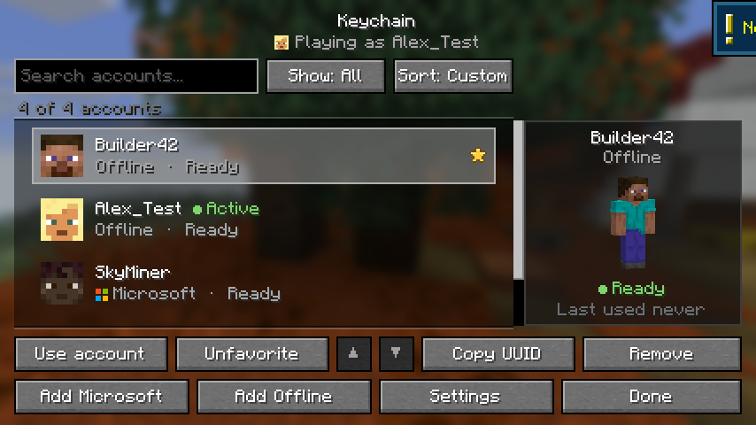
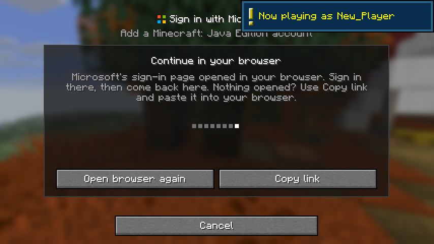
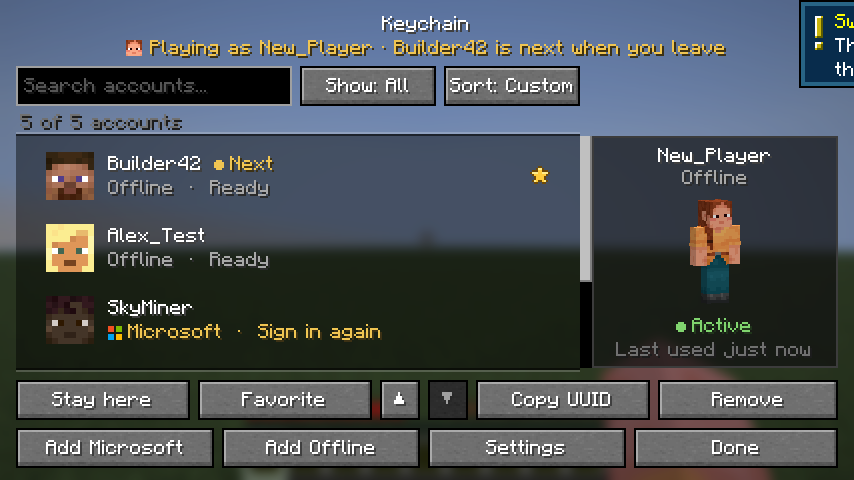
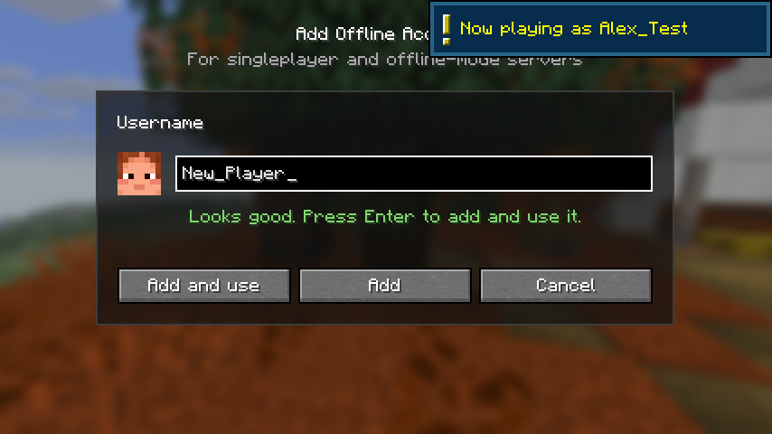
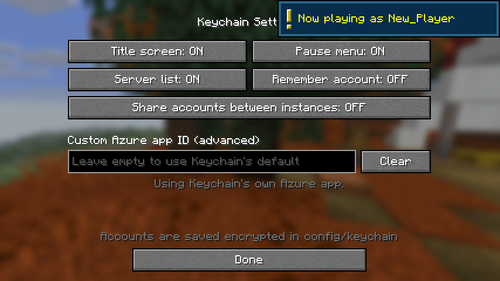

# Keychain 4

Switch Minecraft accounts without restarting the game. Keychain keeps your Microsoft and offline
accounts in an encrypted vault and lets you swap between them from the title screen, the pause menu
or the server list.

Fabric · Minecraft **1.21.11, 26.1 – 26.1.2, 26.2 and 26.3** · requires Fabric API

**[Download the latest release](https://github.com/Domsimus-63/Keychain/releases/latest)** · [Modrinth](https://modrinth.com/mod/keychain)



## Features

- **One-click switching.** Double-click an account, press Enter, or hover a row and click **Use**.
- **Switching that works on real servers.** Keychain rebuilds everything Minecraft ties to the signed-in
  account: chat-signing keys (so servers with secure chat accept you), the services connection,
  player reporting, your profile and skin, and on 26.2+ the friends list.
- **Safe while playing.** Switching inside a world is queued and happens the moment you leave, so
  your current connection never breaks halfway.
- **Microsoft sign-in like the official launcher.** Microsoft's page opens in your browser and
  Keychain picks up the result automatically. If no browser opens, copy the link instead.
- **Clear errors.** "No Xbox profile", "child account", "doesn't own Minecraft" and more are explained
  in plain language with what to do next, plus a *Copy details* button.
- **Sessions that stay valid.** Before switching, Keychain checks the Microsoft session with Minecraft
  services and refreshes it if needed (and picks up name changes). Rarely used accounts are renewed
  in the background about once a week, so they do not expire after Microsoft's 90-day limit.
- **Undo and second chances.** Removing an account offers *Undo* (or Ctrl+Z) for 10 seconds; a
  queued in-world switch can be cancelled with *Stay here*.
- **Find accounts fast.** Search (Ctrl+F), filter (All / Microsoft / Offline / Favorites), sort
  (Custom / Name / Recent), favorites pinned to the top, your own order with ▲▼ or Alt+Up/Down.
- **Skin previews.** Heads in the list and a draggable 3D model of the selected account.
- **Remember account.** Optionally start the game as the account you used last.
- **Share accounts between instances.** Optionally use one account list for every instance on your PC.
- **Stronger storage.** The vault is AES-256-GCM encrypted with a random key that lives outside your
  Minecraft folder, sealed with Windows DPAPI on Windows. Sharing or uploading an instance or modpack
  never shares your tokens.
- **Upgrades itself.** Accounts from Keychain 1.x–3.x are imported automatically on first start.
- **Open it your way.** Key button on the title screen, pause menu and server list, an optional
  *Open Keychain* key (Controls → Keychain), and a *Configure* button in Mod Menu.
- **English, German and Turkish**, with every text ready for more translations.

## Screenshots

| Sign in with Microsoft | Switching from the pause menu |
| --- | --- |
|  |  |
| **Add an offline account** | **Settings** |
|  |  |

## Install

1. Install [Fabric Loader](https://fabricmc.net/use/) and [Fabric API](https://modrinth.com/mod/fabric-api)
   for your Minecraft version.
2. Download **one** Keychain jar from the [releases page](https://github.com/Domsimus-63/Keychain/releases/latest):
   the one for your version, or the universal jar, which contains all of them. Put it in your
   `mods` folder and remove any older Keychain jar (3.x and older are named `keychain-mc...-3.0.jar`).
3. Click the key button next to *Multiplayer* on the title screen.

| Minecraft | Jar | Java |
| --- | --- | --- |
| 1.21.11 | `keychain-4.0.0+mc1.21.11.jar` | 21+ |
| 26.1, 26.1.1, 26.1.2 | `keychain-4.0.0+mc26.1.jar` | 25+ |
| 26.2 | `keychain-4.0.0+mc26.2.jar` | 25+ |
| 26.3 | `keychain-4.0.0+mc26.3.jar` | 25+ |
| any of the above | `keychain-4.0.0-universal.jar` | |

## Where your data lives

| What | Where |
| --- | --- |
| Accounts (encrypted) | `config/keychain/accounts.vault`, or the shared vault below |
| Settings | `config/keychain/settings.json` |
| Vault key, shared vault | `%APPDATA%\Keychain` (Windows), `~/Library/Application Support/Keychain` (macOS), `~/.local/share/keychain` (Linux) |

The vault can only be opened with the key on the computer (and, on Windows, the Windows user) that
created it. On a new computer, Keychain shows *Start fresh*, which keeps the old file as a backup.
Encryption protects against copied or shared files; it cannot protect against malware running as you.

## Building

Requires JDK 25 (the 1.21.11 build still targets Java 21).

```bash
./gradlew buildAll
```

This runs the unit tests and writes every per-version jar to `versions/<mc>/build/libs/` and the
universal jar to `build/libs/`.

In-game tests launch the real client, click through every screen, verify account switching and save
screenshots to `versions/<mc>/build/run/clientGameTest/screenshots/`:

```bash
./gradlew :versions:26.3:runClientGameTest -Pgametest
```

### Layout

| Folder | Contents |
| --- | --- |
| `core/` | Plain Java, no Minecraft: accounts, vault, encryption, Microsoft sign-in. Unit-tested. |
| `common/` | The mod itself (screens, switching, skins), shared by every Minecraft version. |
| `versions/<mc>/` | The few classes that differ between Minecraft versions (`compat` package), plus build settings. |

Adding a Minecraft version usually means copying the newest `versions/<mc>` folder, updating its
`gradle.properties`, and fixing whatever the compiler reports in its `compat` classes.

## License

MIT — see [LICENSE](LICENSE).
