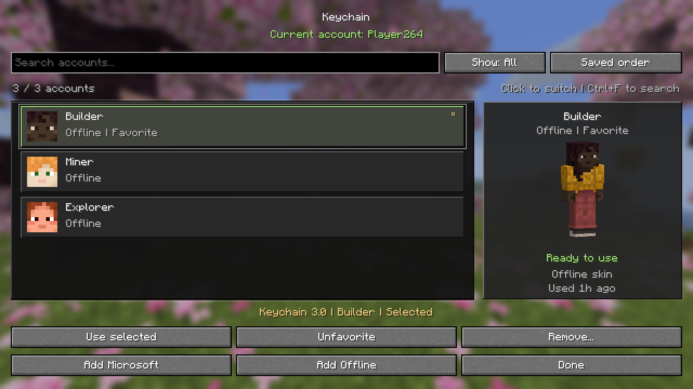

# Keychain 3.0

A Minecraft Fabric account switcher with a cleaner native interface, fast account search, favorites, and skin previews. This release continues the Keychain 2.0 source, reconstructed from the original supplied 1.6.0 JAR, and retains its MIT license and encrypted account format.



## Download

- [Keychain 3.0 universal JAR](downloads/keychain-3.0-universal.jar?raw=true)
- [Keychain 3.0 source ZIP](downloads/keychain-3.0-source.zip?raw=true)
- [Installation guide](downloads/INSTALL.md) and [SHA-256 checksums](downloads/SHA256SUMS.txt)

The universal JAR contains builds for **Minecraft 1.21.11, 26.1.x, 26.2.x, and 26.3.x**. It is not compatible with every Minecraft version. Install Fabric Loader and Fabric API for your game version, then use one Keychain JAR.

In-game UI checks passed on 1.21.11, 26.1, and 26.2. The 26.3 build compiles and passes its unit tests, but live UI verification remains incomplete because the local 26.3 game also crashed in a baseline run without Keychain. See [validation details](VALIDATION.md).

Individual builds are also available:

| Minecraft family | Download |
| --- | --- |
| 1.21.11 | [keychain-mc1.21.11-3.0.jar](downloads/versions/keychain-mc1.21.11-3.0.jar?raw=true) |
| 26.1.x | [keychain-mc26.1-3.0.jar](downloads/versions/keychain-mc26.1-3.0.jar?raw=true) |
| 26.2.x | [keychain-mc26.2-3.0.jar](downloads/versions/keychain-mc26.2-3.0.jar?raw=true) |
| 26.3.x | [keychain-mc26.3-3.0.jar](downloads/versions/keychain-mc26.3-3.0.jar?raw=true) |

## What's new

- Minecraft's own textured buttons and search field, subtle stone panels, and clear current-account markers.
- Instant case-insensitive username search. **Ctrl+F** focuses search; **Esc** clears a nonempty focused search, then closes the screen when pressed again.
- Cycle **Show** through All, Online, Offline, and Favorites. Cycle sorting through saved order, name, and last used. Favorites stay at the top in every view.
- Favorites persist across restarts, Microsoft refreshes, and adding an existing account again. Sorting changes the view without rearranging the saved vault.
- One-click account switching keeps Keychain open. Keyboard users can navigate the list and press Enter, or use the **Use selected** button.
- Hovering a row no longer changes the account selected for removal or other actions.
- Large screens show a draggable 3D skin preview, account type, status, and last-used time. Compact screens prioritize the list and controls. Online heads load asynchronously; offline accounts use Minecraft's UUID-based default skins.
- The offline-account form provides immediate validation, retains its input when resized, and supports Enter to add and use an account.
- The Microsoft sign-in screen has a progress indicator, responsive controls, browser reopening, link copying, and recovery actions. Canceling or leaving sign-in cancels its worker, and queued completions cannot reopen the account screen.
- Successful Microsoft sign-in now both saves and activates the account. Closing during a token refresh prevents its later result from changing the session.
- Malformed vault entries no longer cause partial migrations or silent account loss. Accounts that need reauthentication remain visible. Saving still uses a temporary file and atomic replacement when available; failed favorite saves restore the in-memory state.
- Account removal uses UUID identity, including when an account's username changed. Confirmation explains that the current session remains signed in.
- Keyboard and mouse handling use Minecraft's platform input constants, including the SDL input changes in 26.3.

## Install

1. Close Minecraft and back up `config/account-switcher.json` in your Minecraft instance.
2. Remove the previous Keychain JAR from that instance's `mods` folder.
3. Place **one** Keychain JAR there: the universal JAR or the matching version-specific JAR.
4. Use Fabric Loader and Fabric API for your Minecraft version.
5. Open **K** on the title screen or **Keychain** in the pause menu.

The universal JAR selects its matching nested build. Do not also install a version-specific Keychain JAR.

| Minecraft | Version-specific JAR | Runtime Java | Fabric Loader minimum |
| --- | --- | --- | --- |
| 1.21.11 | `keychain-mc1.21.11-3.0.jar` | 21 | 0.19.2 |
| 26.1.x | `keychain-mc26.1-3.0.jar` | 25 | 0.19.2 |
| 26.2.x | `keychain-mc26.2-3.0.jar` | 25 | 0.19.2 |
| 26.3.x | `keychain-mc26.3-3.0.jar` | 25 | 0.19.5 |

Existing account vaults stay compatible; there is no manual conversion step. Favoriting writes an additional field to the same encrypted account data.

## Build

Use JDK 25 for the build tooling. The legacy output targets Java 21 bytecode and modern outputs target Java 25.

```powershell
.\gradlew.bat build
.\gradlew.bat build '-Pminecraft_version=26.2'
.\gradlew.bat build '-Pminecraft_version=26.3'
.\gradlew.bat -p legacy-1.21.11 build
```

Build all releases and the universal bundle on Windows:

```powershell
.\scripts\build-release.ps1
```

The script writes to `releases/`. An optional `-OutputDirectory` selects another destination. It first synchronizes shared account logic and the updated GUI into the legacy project using `scripts/sync-legacy.ps1`; maintain the modern implementation of those files and rerun this sync after edits. Minecraft version differences in skin loading, session application, and existing mixins remain in their respective source trees.

The source archive contains Gradle wrappers, source, resources, tests, and release scripts. Game files, run directories, logs, account vaults, and test fixtures are excluded.

## Verification and limitations

See `VALIDATION.md` for the build matrix and the exact scope of the in-game checks. Microsoft UI checks use a simulated pending sign-in; end-to-end Microsoft authentication with a real account and online skin downloads were not performed for this release.

Switching while already in a world does not change an existing server connection's identity. Reconnect for that connection to use the newly selected account. Offline accounts are intended for singleplayer and offline servers.

The vault retains Keychain's original machine-derived AES encryption for backward compatibility. Protect the Minecraft configuration folder: this is not an operating-system credential vault or password-protected storage.
